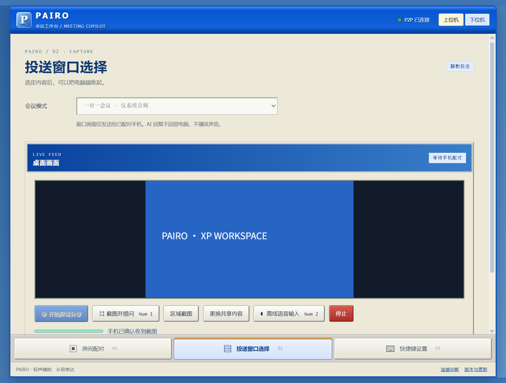

# PAIRO · 把会议提示留在手机上

电脑在后台投送问题，手机安静显示 AI 回答，像一份持续更新的发言稿。电脑不弹出回答、不播放声音，让会议投屏保持干净。

需要 Windows 10 / 11 的 64 位电脑、Android 8 或更新版本的手机，以及同一个可信局域网。电脑也可以连接手机热点。使用 AI 时，请在手机里填写自己的服务地址、模型名称和 API Key。

**源码正在准备 0.3.0 XP 工作台改版，尚未发布。** 最新已发布版仍是 [v0.2.0](https://github.com/BuanDesu/p2p-meeting-copilot/releases/tag/v0.2.0)，界面不同，安装和使用方法见 [0.2.0 指南](docs/USAGE_v0.2.0.md)。发布页 Assets 提供 EXE、目录 ZIP、正式签名 APK 和校验文件，普通用户不用安装编程工具。私有仓库需要登录有访问权限的 GitHub 账号。

以下指南对应 **0.3.0 改版**，两端必须同时更新，旧版无法与新版配对。Windows 目前没有代码签名证书；Android 延续固定正式签名。

## 电脑：准备完成，然后收起

底部有 **房间配对、投送窗口选择、快捷键设置** 三页。切页保留房间和手机连接。

1. 在“投送窗口选择”选好会议模式和声音来源，点击“开始屏幕分享”，选择要投送的窗口或屏幕。只换窗口时点“更换共享内容”，不用重新扫码；更改声音来源需重新开始分享。
2. 在“房间配对”显示二维码和房间码，让手机扫码。确认是自己的手机后点击“允许此手机”。多个电脑地址中，选择当前 Wi-Fi 或网线对应的地址。
3. 在“快捷键设置”启用会议快捷键，按需要修改按键并保存。要用语音时，先点“下载离线语音组件”。准备完成后“收起到托盘”。

关闭电脑主窗口也会收起，分享继续；双击系统托盘 **P** 图标恢复，右键“退出并结束会话”才彻底退出。后台快捷键不会自动打开窗口或抢焦点。窗口、麦克风授权仍由你在准备阶段确认。

## 手机：连接、配置、阅读

- **房间配对**：扫码填写地址和房间码，核对后连接，也可手动输入。永久拒绝相机后，到手机“设置 → 应用 → PAIRO → 权限”重新允许。
- **API-KEY配置**：复制服务商完整的 Chat Completions 地址、准确模型名和 Key，点“测试 AI 配置”。截图分析需要支持图片的模型，测试和提问可能计入服务商用量。Key 仅存于本次运行内存，退出需重填。
- **会议助手**：竖屏聊天室，以文本回答为主，小输入栏用于补充问题；支持取消等待、修正配置后重试和清空。向上阅读后暂停自动追随新回答，滚回底部后继续跟随。

电脑的截图提问、语音转写和文本投送会自动请求模型，即使“收到普通问题后自动请求模型”未勾选也生效。实时视频不会逐帧上传给 AI；语音和文字问题不会自动夹带上一张截图。手机手动输入时，可用附件旁的 × 移除图片。

## 会议快捷键

**Num1 / Num2 / Num3 指右侧小键盘，请开启 Num Lock。** 可改为 `Ctrl+Alt+S`、`F8` 等组合。快捷键只在分享期间且已启用时占用，结束分享释放；↑ / ↓ 也会占用其他程序方向键，不需要时关闭或修改绑定。

| 默认键 | 操作 |
| --- | --- |
| **Num1** | 截取已选窗口当前画面，传到手机自动提问；默认“请回答图中的问题。”，可修改 |
| **Num2** | 开关本机离线语音转写，识别文字送到手机自动提问 |
| **Num3** | 开关主窗口内文本输入栏，输入后点“发送”；不弹窗，不读取其他程序的输入 |
| **↑ / ↓** | 上下滚动手机会议助手消息区 |

按键冲突时显示错误并保留此前可用绑定。主窗口在前台且正在编辑输入框时，按键优先用于输入。“区域截图”保留手动框选；Num1 直接截取已选窗口，不弹出选区框。AI 回答只在手机显示，没有朗读按钮。

## 会议模式与离线语音

| 模式 | 来源与行为 |
| --- | --- |
| 会议助手 | 系统输出与可选电脑麦克风混合，Num2 开启后持续分段转写并提问 |
| 一对一会议 | 只接电脑系统输出，不申请麦克风；Num2 控制持续转写会议对方的声音 |

Windows 系统音频包含其他应用的声音，会议前请关闭无关播放。手机会议助手底部可展开“一对一会议 · 查看电脑画面与声音”，主动点“开启声音”播放；默认收起且不播放，电脑始终静音。

离线识别使用 [whisper.cpp](https://github.com/ggml-org/whisper.cpp) 固定 Windows CPU 引擎和多语言 tiny 模型，首次约下载 80 MB，分别校验 SHA-256，保存在电脑 `PAIRO-data/offline-speech`，无需语音 API Key。之后转写可离线使用；AI 回答仍需手机联网。停顿或最长约 12 秒分段，不是逐字实时字幕；质量取决于口音、噪声与电脑性能。

音频不上传外部转写服务；中文识别结果在本机统一转为简体，再从手机发给你配置的 AI。繁简转换不纠正听错的内容，嘈杂环境建议使用近距离麦克风或耳机。识别会短暂生成本地 WAV／文本文件，完成或取消后清理；异常退出留下的工作文件在下次启动清理。Num2 关闭会取消未完成转写，房间保留。

## 遇到问题与更新

| 现象 | 处理方式 |
| --- | --- |
| 手机连不上 | 确认同一局域网、电脑仍运行；手机不能填 localhost / 127.0.0.1，可点“检测电脑连接” |
| 截图无回答 | 核对手机 Key、模型与错误提示，模型需支持图片；确认手机已收到截图 |
| 没有语音文字 | 先下载离线组件，确认有音频来源，再按 Num2；静音不提交，首次结果需等待分段 |
| 组件下载失败 | 检查 GitHub、Hugging Face 是否可访问及目录是否可写，然后重试 |
| 转写跟不上 | 减少其他电脑负载后重试；队列有上限，超出会停止并提示，不无限积压旧语音 |
| 找不到窗口 / Num3 无弹窗 | 双击托盘 P 图标，主动打开“投送窗口选择”中的文本栏 |
| 新旧版连不上 | 同时更新电脑 EXE 和手机 APK |

“连接诊断”只包含版本、状态和轨道数量，不含 Key、地址、房间码和内容。“版本与更新”手动查询正式发布，私有仓库请登录 GitHub 查看。

更新前结束会话，从托盘退出电脑程序，替换 EXE 或完整解压新 ZIP，保留旁边的 `PAIRO-data`；手机用新 APK 覆盖安装。首次从 0.1.0 调试签名迁移见旧版指南。

开发与构建见 [开发指南](docs/DEVELOPMENT.md)，改版进度见 [本轮 TODO](docs/XP_WORKSPACE_TODO.md)。另一网络／多网卡真机验收与 Windows 证书仍保留在 [原清单](docs/TODO.md)，不会用本轮界面检查代替。
