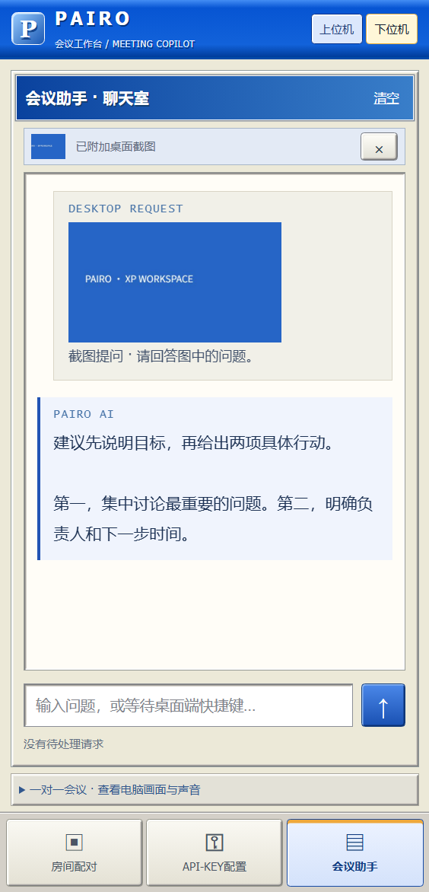

# PAIRO Meeting Assistant · 把会议提示留在手机上

PAIRO 是一个同时在电脑和手机上使用的会议助手。电脑把你指定的截图、文字或语音转写结果发给手机，由手机请求 AI，再把回答显示在手机上。

你可以把它当作一份不断更新的发言提示：会议投屏留在电脑，回答留在手边的手机。准备完成后，电脑端可以收进右下角托盘，使用快捷键操作，不会自动弹出回答或朗读。

**当前正式版：v0.3.0。** 第一次使用，按下面的“下载 → 配对 → 设置 AI → 开始使用”操作即可，不需要安装编程工具。

## 1. 下载到电脑和手机

你需要一台 **Windows 10/11 的 64 位电脑**、一部 **Android 8 或更新版本的手机**，以及可用的 AI 服务。

| 在哪里使用 | 下载哪个文件 | 下载后怎么做 |
| --- | --- | --- |
| Windows 电脑，方便直接打开 | [Windows EXE](https://github.com/BuanDesu/PAIRO-Meeting-Assistant/releases/download/v0.3.0/Pairo-Meeting-Copilot-0.3.0-win-x64.exe) | 放到自己可写的文件夹，双击运行 |
| Windows 电脑，希望以后打开更快 | [Windows ZIP](https://github.com/BuanDesu/PAIRO-Meeting-Assistant/releases/download/v0.3.0/Pairo-Meeting-Copilot-0.3.0-win-x64-folder.zip) | 先完整解压，再双击里面的 `Pairo Meeting Copilot.exe` |
| Android 手机 | [Android APK](https://github.com/BuanDesu/PAIRO-Meeting-Assistant/releases/download/v0.3.0/Pairo-Meeting-Copilot-0.3.0-android.apk) | 在手机打开文件，按系统提示允许安装 |

电脑版 EXE 和 ZIP 任选一种；手机还需要安装 APK。

[查看完整发布页](https://github.com/BuanDesu/PAIRO-Meeting-Assistant/releases/tag/v0.3.0) · [文件完整性校验](https://github.com/BuanDesu/PAIRO-Meeting-Assistant/releases/download/v0.3.0/SHA256SUMS.txt)

仓库已改用 **PAIRO-Meeting-Assistant** 名称；v0.3.0 已发布安装包仍保留原文件名，方便已有下载链接和校验文件继续使用。Windows 程序目前没有代码签名证书。

## 2. 先把电脑和手机连起来

### 先准备网络

让电脑和手机连接同一个 Wi-Fi。也可以用手机开热点，让电脑连接这个热点。电脑与手机要能在这个局域网内互相访问。

程序里的“上位机”指电脑，“下位机”指手机。

### 在电脑上操作

1. 打开 PAIRO，进入底部的 **“投送窗口选择”**。
2. 选择会议模式。想识别自己和会议对方的声音，选 **“会议助手”** 并按需启用麦克风；只识别电脑里播放的会议对方声音，选 **“一对一会议”**。
3. 点击 **“开始屏幕分享”**，在预览中选择要分享的窗口。选择单个窗口，便于控制截图会包含哪些内容。
4. 进入 **“房间配对”**，保留电脑显示的二维码，供手机扫描。如果有多个连接地址，选择当前 Wi-Fi 或网线对应的那个。

### 再在手机上操作

1. 打开 PAIRO，进入 **“房间配对”**。
2. 点击 **“扫码配对”**，允许相机权限，扫描电脑二维码。
3. 扫码填好信息后，点击 **“连接”**。
4. 回到电脑，确认是自己的手机，点击 **“允许此手机”**。
5. 两端显示 **“P2P 已加密直连”**，就配对成功了。

无法扫码时，也可以把电脑显示的手机连接地址和房间码手动填到手机。地址要完整复制，包括最后的端口号；手机不要填写 `localhost` 或 `127.0.0.1`，它们指向手机自身。

## 3. 在手机上设置 AI

进入手机底部的 **“API-KEY配置”**。这三个信息都由你使用的 AI 服务商提供：

| 要填写什么 | 到哪里找 / 怎么填 |
| --- | --- |
| API 地址 | 复制服务商给出的完整聊天接口地址，通常以 `/chat/completions` 结尾 |
| 模型名称 | 复制服务商提供的准确名称，按原样填写 |
| API Key | 在服务商后台创建并复制访问 Key，只填写到应用里 |

填好后，点击 **“测试 AI 配置”**。测试成功后，去 **“会议助手”** 输入一个简单问题，点发送，先确认能收到回答。

要让 AI 看截图，所选模型还需要支持图片输入。文字测试成功后，可以再用截图试一次。测试和提问可能计入服务商用量；PAIRO 本身不提供 AI 额度。

Key 不会保存为下次启动的设置，重新启动应用后需要再次填写。分享截图或报错信息时，请遮住 Key；不需要把 Key 发到仓库、Issue 或聊天中。

## 4. 开始使用会议助手

**版本说明：下面的选区提问、回答键入是下一版的新功能，尚未包含在第 1 节的 v0.3.0 下载包中。v0.3.0 的 Num3 仍是主窗口文本输入栏；新操作需要电脑和手机同时更新后使用。**

先在电脑 **“快捷键设置”** 中启用快捷键。使用右侧小键盘时，请开启 **Num Lock**；没有小键盘，可以在这里改成自己方便的组合键。

| 默认按键 | 按下后会发生什么 |
| --- | --- |
| **小键盘 Num1** | 截取已选窗口的当前画面，发到手机，并自动问 AI；默认问题是“请回答图中的问题。” |
| **小键盘 Num2** | 开启或关闭语音转文字；识别出的文字发到手机并自动提问 |
| **小键盘 Num3** | 在其他程序选中文字后按下，复制本次选区，发到手机并自动提问；无需打开电脑主窗口 |
| **Shift + 小键盘 Num3** | 手机回答完成后，先点击电脑里需要填写的输入框，再按此键，逐字键入手机最新一条完整回答 |
| **↑ / ↓** | 上下滚动手机的回答区域 |

**第一次使用语音**：在电脑“快捷键设置”点 **“下载离线语音组件”**，约 80 MB。完成后再按 Num2。识别会在停顿或一段话结束后提交，不是逐字出现的实时字幕；嘈杂环境可尝试近距离麦克风或耳机。

**准备好后收起电脑端**：点击“收起到托盘”，或关闭主窗口。PAIRO 仍在后台运行。选中文字、按 Num3、在手机阅读回答即可，电脑不会自动弹窗或播放回答。

**需要把回答填回电脑时**：等待手机回答全部完成，点击问卷等程序中要填写的普通输入框，再按 **Shift + Num3**。无论这条回答来自选中文字、截图还是语音，都可以使用。它只键入最新一条完整回答，不会自动提交表单；输入前先确认光标位置，输入后检查内容。回答生成中、失败、取消或清空后不会沿用旧回答。

默认速度是中文 **60 字/分钟**、英文 **90 词/分钟**。在电脑 **“快捷键设置 → 回答键入速度”** 可分别修改并保存；英文按每词 5 个字符折算，混排分别计时。换行和制表符转为空格，避免代按回车提交。目标程序处理较慢时实际速度也可能降低。

键入途中按 **Esc** 或再次按 **Shift + Num3** 可停止；切换窗口、换到其他输入框、断开连接或关闭快捷键也会停止。Esc 只在等待回答／键入期间临时占用。不支持密码框、只读框、管理员权限窗口，以及未开放可编辑信息的自定义控件；停止前已填入的文字会保留，请自行检查。

方向键会被会议快捷键占用。如果还要用其他软件的 ↑/↓，先换一组快捷键，或暂时关闭会议快捷键。按键发生冲突时，程序会提示并保留此前可用的设置。

手机的 **“会议助手”** 页面用于阅读和补充提问；可以取消等待、清空，或修正配置后重试。向上阅读时，新回答不会强行把页面拉到底部。需要实时查看电脑画面、听电脑声音时，展开底部的 **“一对一会议 · 查看电脑画面与声音”**，再点“开启声音”。

## 5. 换窗口、结束会议与更新

- **只换要分享的窗口**：电脑点击“更换共享内容”，手机不用重新扫码。
- **更改声音来源或会议模式**：停止当前分享，重新开始并配对。
- **暂停语音提问**：再按一次 Num2。
- **结束共享**：电脑点击“停止”，或从托盘右键选择“退出并结束会话”；手机也可以在配对页点“断开当前房间”。关闭电脑主窗口会收进托盘，共享会继续。
- **更新软件**：先结束会话并从托盘退出电脑程序，再替换 EXE，或完整解压新 ZIP；保留旁边的 `PAIRO-data` 文件夹。手机打开新 APK 覆盖安装。电脑与手机都更新到同一版本。

## 遇到问题时先看这里

| 遇到什么 | 先检查什么 |
| --- | --- |
| 手机连不上电脑 | 两台设备是否在同一个 Wi-Fi / 手机热点；电脑程序是否仍在运行；手机地址是否从电脑完整复制。可点“检测电脑连接” |
| 扫码时无法打开相机 | 到手机“设置 → 应用 → PAIRO → 权限”允许相机，再回到应用扫码 |
| AI 配置测试失败 | 核对服务商给出的完整地址、模型名称、Key，以及服务余额和手机网络；按应用提示修改 |
| 收到截图却没有正确回答 | 检查模型是否支持图片、截图中问题是否清晰，以及手机显示的错误提示 |
| 按快捷键没有反应 | 先开始分享并连接手机，再启用会议快捷键；检查 Num Lock、按键冲突，或换成组合键 |
| 按 Num3 没收到新问题 | 先确认两端版本、连接与快捷键已启用，再在原程序选中文字；没有选区时不会使用旧剪贴板内容 |
| Shift + Num3 没有键入 | 等手机回答完成，先点击普通可编辑输入框；查看电脑主窗口“投送窗口选择”底部的状态。两端需同时更新；Esc 被占用时不会开始 |
| 语音没有变成文字 | 确认离线组件已下载、有实际声音来源，并已按 Num2；说完停顿片刻再看手机 |
| 离线组件下载失败 | 确认电脑能访问 GitHub 和 Hugging Face，程序所在目录可写，再重试 |
| 转写跟不上或内容听错 | 降低环境噪声、减少电脑其他负载；离线 tiny 模型有精度限制，必要时在手机输入栏补充正确问题再发送 |

## 内容会去哪里？

- 电脑画面和声音通过加密的 P2P 连接传给你允许加入的手机。
- 语音在电脑本机转成文字，中文结果统一为简体；音频不发给外部语音转写服务。
- 提问时，问题文字和相应截图会发给你在手机上配置的 AI 服务。持续播放的画面不会逐帧送给 AI；语音和文字提问也不会自动夹带上一次截图。
- Num3 只在按下时读取选区。程序优先直接读取所选文字，必要时模拟一次复制并尝试恢复剪贴板；不连续记录键盘文字。Shift+Num3 才会从已配对手机取回最新完整回答，临时保留在内存中并键入你选择的输入框，不在电脑界面展示或写入设置、日志。
- 系统音频可能包含其他软件的声音，使用前请关闭无关播放；想限制截图范围，选择单个窗口。
- `PAIRO-data` 保存本机运行设置和缓存；离线转写的临时音频完成或取消后清理，异常退出留下的工作文件在下次启动清理。连接诊断不包含 Key、地址、房间码或对话内容。

仓库隐私检查见 [检查记录](docs/PRIVACY_REVIEW_2026-10-16.md)。当前主要面向同一可信局域网；另一网络／多网卡组合的完整真机验收，以及 Windows 代码签名仍在 [待办](docs/TODO.md) 中。

需要开发、修改或自行打包，见 [开发指南](docs/DEVELOPMENT.md)。旧版界面说明见 [v0.2.0 指南](docs/USAGE_v0.2.0.md)。
