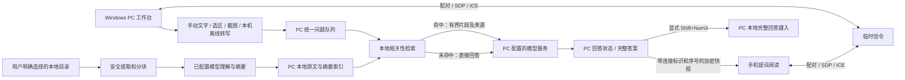

# 项目流程与职责（0.5.0 开发版）

- PC 持有 API Key，只存当前运行内存。问题、截图和相关知识片段只由 PC 发给配置服务；无关提问没有额外远程分类调用。
- 手机只配对、接收提词和阅读滚动，不配置 API、不输入模型问题、不发起推理。可展开原有共享画面/音频监看。
- 信令不接收问题、Key、索引或答案。WebRTC 加密传输；现有媒体选择、托盘静默与原生快捷键保留。
- 新协议 5 明确拒绝旧端（包括旧 0.5.0）。已批准手机网络恢复时重新获取快照；批准新手机后清空旧会话。停止共享保留原房间和提词，结束会话才清理并撤销配对。

## 模块

| 模块 | 职责 |
| --- | --- |
| `src/main.js` | 角色 UI、采集、连接和入口编排 |
| `src/meeting-engine.js` | PC 队列、历史、取消、重试及完整答案状态 |
| `src/prompter-sync.js` | 有界快照、连接标识、顺序与慢速发送合并 |
| `src/llm.js` / `completion-stream.js` | 请求验证、消息构建、流式解析、完成判定 |
| `electron/model-service.cjs` / `preload.cjs` | 可信 IPC、主进程 HTTP、取消与凭据边界 |
| `electron/knowledge-files.cjs` | 目录范围、格式、大小、敏感内容检查及文本提取 |
| `electron/knowledge-service.cjs` | 原生目录来源、模型理解、增量缓存、本地持久化与管理 |
| `src/knowledge-index.js` | 内存倒排索引、词频加权、命中阈值和上下文预算 |
| `src/knowledge-ui.js` | 知识库进度、摘要/来源、更新和删除 |
| `electron/text-automation.cjs` | 前台输入保护、速度设置、取消和焦点检测 |
| `src/peer-session.js` / `data-channel.js` | WebRTC 配对、分块、背压、重连 |

## 数据与限制

目录选择和索引只在 PC。知识库正文作为不可信参考，不执行文档命令；过滤不能代替用户自行移除敏感资料。索引保存在应用用户数据目录，便携版位于 `PAIRO-data/knowledge-base/store.json`，不打入包、不写日志、不加入 Git。文件移除只改变索引；增量更新才同步原文删除。

检索依赖文字/标识符匹配，不假定 Chat Completions 提供 embeddings。支持简短指代追问；语义近似但无共同词语的问题可能未命中，此时按通用知识回答，不编造项目事实。支持格式、导入上限与具体使用见仓库 README；测量与验证见 [验证记录](ARCHITECTURE_VALIDATION.md)。
