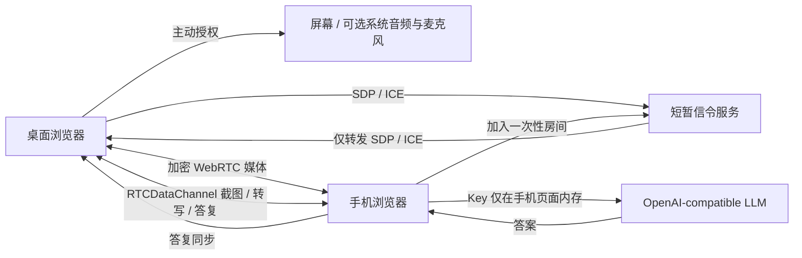
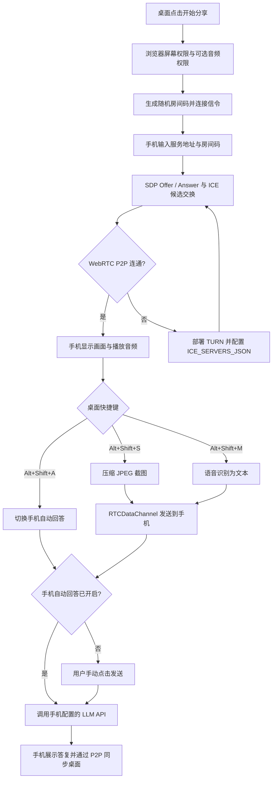

# 项目流程树

## 端到端工作流



## 设备操作



## 仓库结构

```text
p2p-meeting-copilot/
├─ docs/ (部署、计划、进度、流程)
├─ server/signaling.js      # 临时信令，仅转发 SDP/ICE
├─ src/main.js              # 双端 UI、采集快捷键、请求编排
├─ src/peer-session.js      # WebRTC / RTCDataChannel
├─ src/llm.js               # 手机直连 OpenAI-compatible API
├─ src/styles.css           # 响应式主题
├─ test/                    # 信令集成测试
├─ index.html
├─ package.json
└─ vite.config.js
```

## 信任边界

- 信令服务可以看到房间码与连接协商元数据，但不接收屏幕帧、语音内容、对话或模型 Key。
- WebRTC 媒体与数据通道由浏览器加密；公网环境仍需要 TLS 信令并配置可靠 ICE/TURN。
- 手机客户端持有模型 Key 并直接发给其 API endpoint；endpoint 提供方能够读取请求中的文本/图像。
